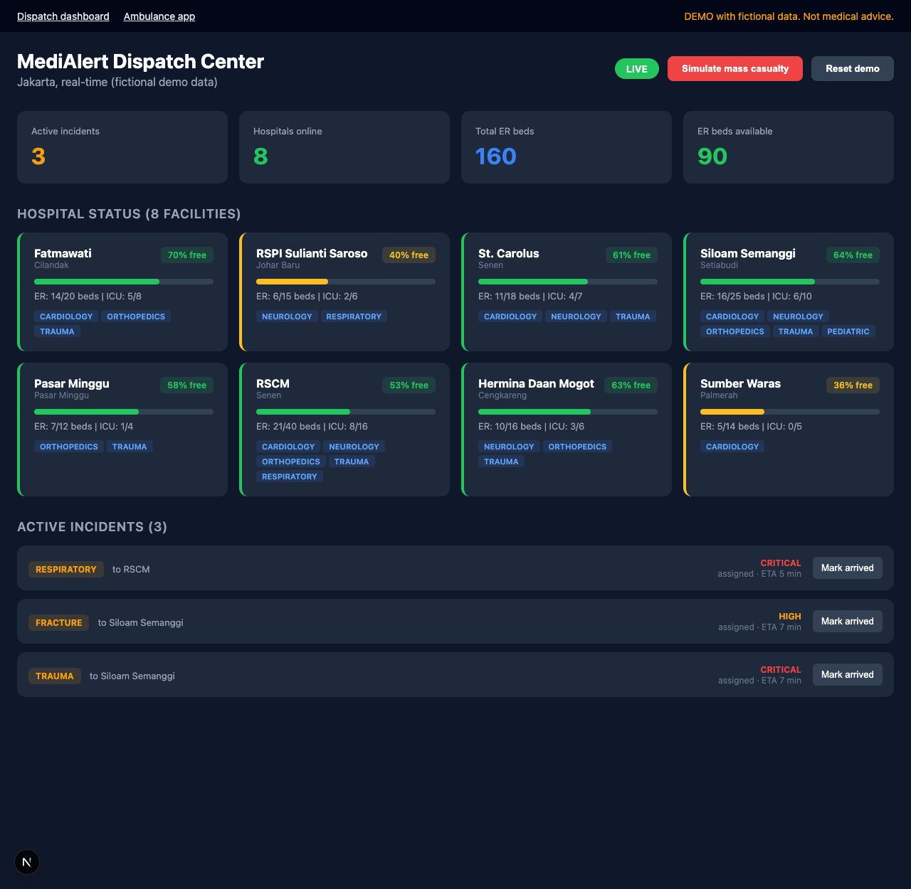
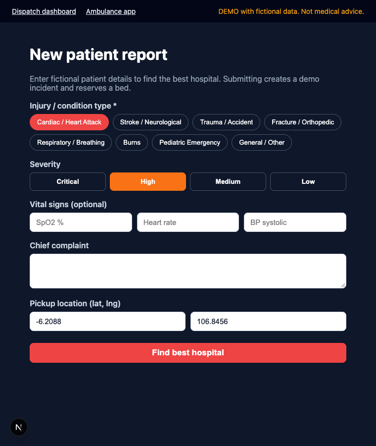
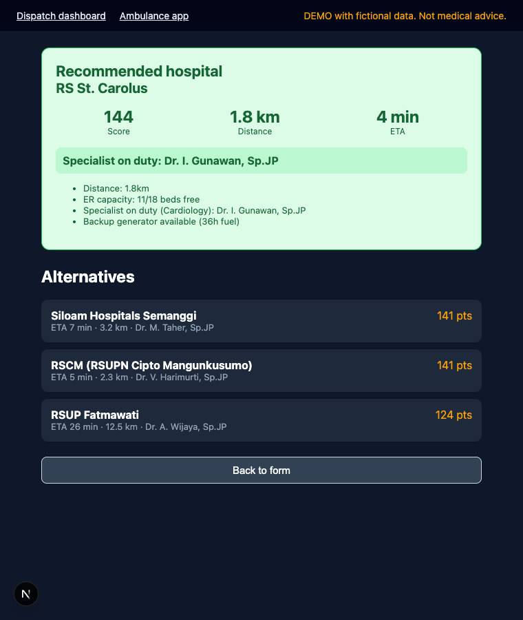

# MediAlert Network

> "Waze for ambulances": real-time hospital capacity and specialist-aware ambulance routing.

**This is a hackathon demo built on fictional data. It is not a medical device and gives no medical advice. Do not use it for real patients or real emergency decisions.**

## The problem

During an emergency, an ambulance often drives to the nearest hospital, only to find the ER full, the ICU out of beds, or the needed specialist off shift. Every minute lost re-routing is a minute the patient does not have. Dispatchers and paramedics rarely have live, shared visibility into hospital capacity.

## The solution

MediAlert Network gives dispatchers and paramedics one live view of hospital capacity and recommends the best destination for each patient.

- **Dispatcher dashboard:** live ER/ICU bed counts, on-duty specialists and active incidents for 8 Jakarta hospitals, updated over Socket.io.
- **Ambulance app (web form):** the paramedic enters condition, severity and optional vitals; the routing engine returns a ranked recommendation with the reasons behind it.
- **Routing engine:** filters out hospitals with no ER bed (or no ICU bed for critical patients), then scores the rest on distance, capacity, matching specialist on duty and backup power.
- **Mass-casualty simulation:** one click creates three simultaneous incidents and watches beds being reserved across hospitals in real time.

## Screenshots

| Dispatch dashboard | Ambulance form | Recommendation |
|---|---|---|
|  |  |  |

## Architecture

```
apps/web (Next.js)  <--REST + Socket.io-->  server (Express + Socket.io, in-memory store)
        \                                          /
         +------ packages/shared: types, mock data, routing engine ------+
```

- `packages/shared`: TypeScript types, fictional hospital data and the pure `routePatient` function (unit tested).
- `server`: REST API (`/api/hospitals`, `/api/incidents`, `/api/routing`) and Socket.io events (`hospital:capacity_change`, `incident:new`, `incident:arrived`, `alert:mass_casualty`). State is in memory and resets on restart.
- `apps/web`: dispatcher dashboard (`/`) and ambulance form (`/ambulance`).

Scoring (start at 100): distance penalty up to -30, ER capacity up to +20, ICU capacity up to +15 for critical cases, specialist on duty +25 or -15 if missing, backup generator with more than 6 h of fuel +10. Patients are treated as critical if severity is critical or vitals cross simple thresholds (SpO2 < 90, systolic BP < 90, heart rate > 150 or < 40). These weights are illustrative, not clinically validated.

## Tech stack

TypeScript, Node.js 20+, Express, Socket.io, Next.js 15 / React 19, Vitest, Supertest.

## Getting started

Requires Node.js 20 or newer.

```bash
npm install
cp .env.example .env   # optional, defaults work
npm run dev            # API on :4000, dashboard on :3000
```

Open http://localhost:3000. Click "Simulate mass casualty" and watch beds and incidents update live; open http://localhost:3000/ambulance to request a recommendation.

Other commands:

```bash
npm test          # unit + API + Socket.io tests (Vitest)
npm run typecheck # TypeScript across all workspaces
npm run build     # production build of the web app
```

Verified with Node 22 and npm 10: install, 16 tests passing, typecheck clean, production build succeeds, and both pages work against the running API.

### API quick look

```bash
curl -X POST localhost:4000/api/routing/recommend -H 'Content-Type: application/json' \
  -d '{"injuryType":"cardiac","severity":"high","pickupLat":-6.2088,"pickupLng":106.8456}'
```

## Data and privacy

All data is fictional. Hospital names are real public institutions used only as recognisable Jakarta labels; bed counts, generator status and doctor names are invented and do not represent the real facilities, who are not affiliated with this project. No patient data is collected or stored, and there are no secrets or external services required.

## Hackathon context and project history

MediAlert Network was prepared for Garuda Hacks 7.0 (Healthcare and Public Safety tracks). The author was a participant; no placement or award is claimed. The original pitch material (deck outline, architecture notes, `.pptx` and `.docx` generators) is kept under [`docs/`](docs/). The original plan also mentions PostgreSQL, Redis, Mapbox and a React Native ambulance app; those are roadmap ideas and are **not** implemented here. The current version uses an in-memory store and a web-based ambulance form instead.

## Roadmap

- Persistent storage (PostgreSQL) and authentication for hospital staff
- Map view with traffic-aware ETA (Mapbox)
- Native or offline-first ambulance app
- Clinically reviewed scoring rules

## Author

Muhamad Septian Pamungkas ([@seppam](https://github.com/seppam))

Licensed under the MIT License.
